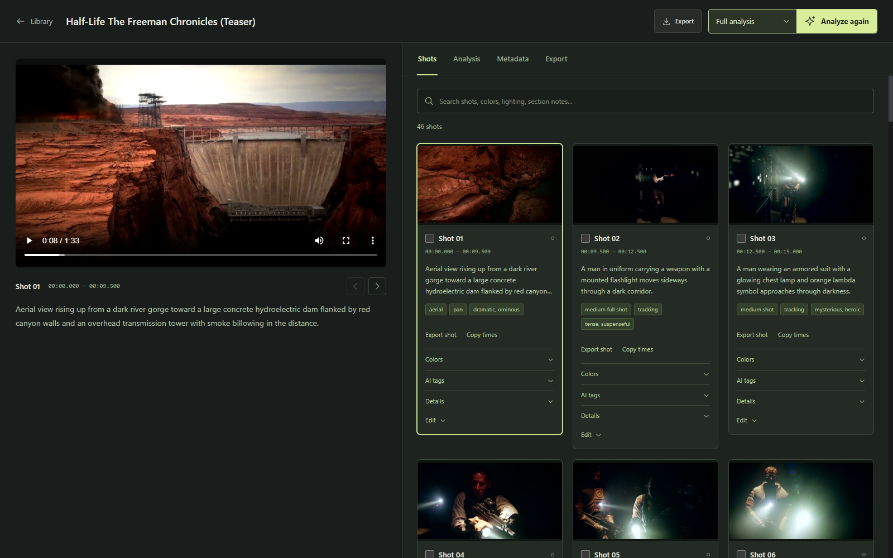
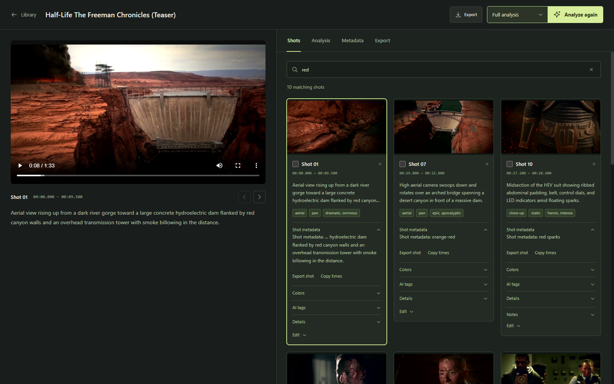
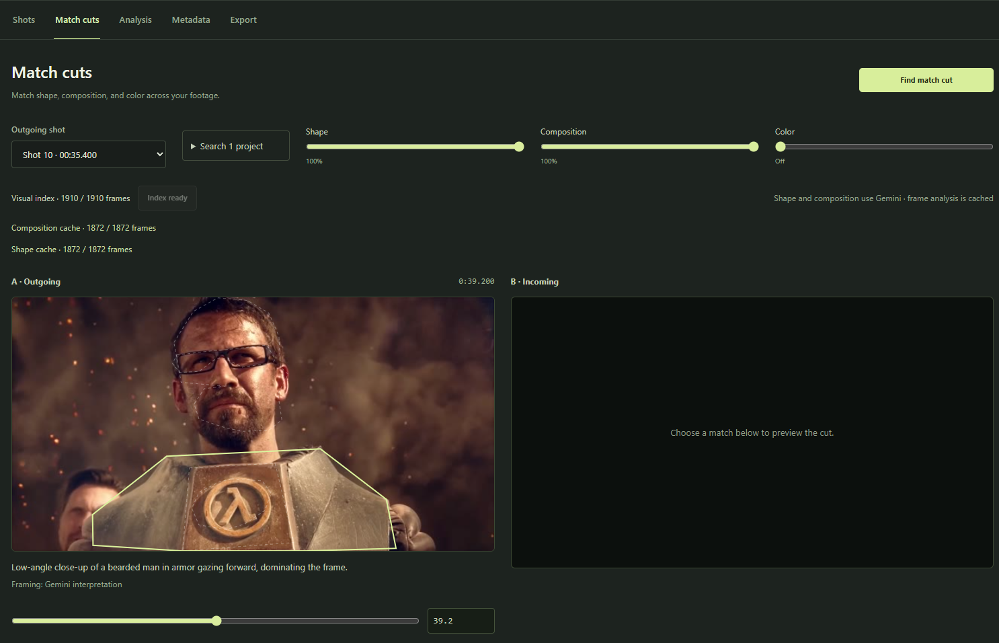
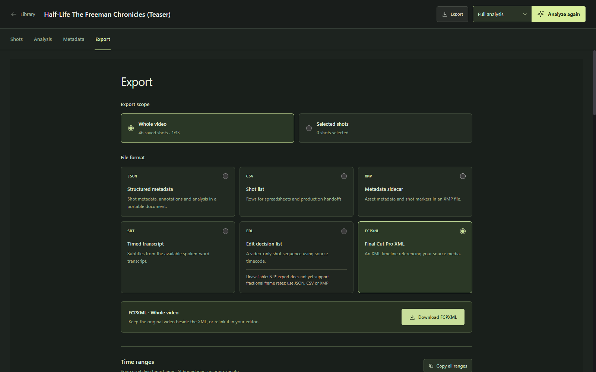

# Video Analyzer

Turn footage into a searchable shot library with Gemini analysis, visual match-cut discovery, editable metadata, and exports for the edit. Built for agency teams finding and reusing footage, and filmmakers exploring their material.



Match cuts can search **All media**, **This media**, or **Selected media / folders**. The picker supports multiple folders, individual media, and select-all. An analyzed single-take recording is searchable without splitting it into multiple clips. Folder and library scopes refresh when the panel is reopened; unavailable sources are reported while available recordings remain searchable. Searches larger than 20 sources are combined into one ranked result list.

Library filters use recorded **Production, Scene, Take, Camera roll, and Cinematographer** slate metadata, plus analysis and personal tags. A manually assigned production label is also searchable. Media filters match any slate in a source; clip filters match the slate on that clip. Scene and take selections must match the same board. Dropdowns show metadata available in the selected folder, with missing fields disabled. Review status, rights, and collection controls have been removed from the library and clip editor; older stored values are preserved for compatibility.

On Windows, generated viewing and playback proxies live in `%LOCALAPPDATA%\VideoAnalyzer\media\<media ID>\`, separate from linked originals. Available proxies keep playing when the original NAS or drive is offline. A small **Original media offline** warning appears by the name in library cards and the media header, refreshing every ten seconds and when the window regains focus. The player reports an offline original separately from a missing proxy or browser decode failure, and offers **Retry playback** after reconnection. Source and proxy changes still invalidate playback; analysis and editor operations retain their original-media identity checks.

## Camera previews and display color

Camera previews preserve anamorphic framing in square pixels, including JPEG thumbnails and vision frames. Very short recordings show their fractional duration and decoded frame count, with a **Loop preview** control. Mac `._` resource files and `__MACOSX` folders are ignored during import.

**Metadata → Advanced display color** offers reversible viewing transforms. New R3D imports develop through the RED SDK into Rec.709 while retaining recorded white balance, ISO and exposure; existing R3D imports can select **RED SDK → Rec.709**. ARRI RAW develops to Rec.709 and applies its recorded anamorphic desqueeze. For **Zenmuse X5S/X7 D-Log** footage, select the corresponding DJI transform: the app downloads, verifies and caches [DJI’s official display LUT](https://www.dji.com/downloads/softwares/transcoding-zenmuse-x7-rec) on first use. Other DJI Log profiles are not inferred from generic Rec.709 container tags. DJI Inspire 3 / Zenmuse X9 D-Log uses the separate X9 display transform. Display choices are saved for each unchanged original, even if its library entry is removed, and reapplied directly from the original on reimport. Generic ProRes/Rec.709 tags never trigger a guessed DJI LUT. Color changes affect playback and future analysis, preserve original media and edit metadata, and check cadence, duration and audio. Reanalyze existing results to refresh color descriptions and clip thumbnails.

## From import to edit

1. **Drop videos or whole camera folders.** Multiple folders and nested subfolders import their video files as individual **media items**, ignoring sidecars and grouping numbered camera recording parts. Originals remain linked to their local or network location. Preview and organize footage without an AI key; analysis and metadata persist in SQLite across restarts. The arrow beside **Import** also offers **Import folders**.
2. **Choose Clips and tags or Full analysis.** Select individual media items or **Select page**, choose the analysis type, and click **Analyze selected**. Two analyses run concurrently by default; the rest wait in the queue. Each card shows its current stage and progress. Failed requests remain selected for retry. Gemini identifies **clips** within each media item and describes subjects, actions, colors, camera movement, and audio. Full analysis adds deeper cinematography, editing, narrative notes, and a video summary. Known-duration videos are processed in 30-second sections; clips and midpoint thumbnails appear as sections finish after provider upload processing.
3. **Find and review clips.** Search inside one media item, play matching clips, edit human tags and notes, and record review and usage-rights status. Open an analysis section to jump back to its clips.
4. **Explore visual match cuts.** Select a detected shape or trace your own outline, then search for similar silhouettes, framing, and colors across selected shots.
5. **Export the whole shot or selected clips.** Download metadata and editorial interchange files, or copy individual in/out times and clip ranges.

Move left or right across a library thumbnail to scrub its footage silently. The preview uses the ready viewing proxy or a directly playable original, loads only while hovered, and returns to the poster when you leave. In the **Clips** view, scrubbing stays within the clip's in/out range. Clicking still opens the viewer; selection and dragging into folders remain available.

## Organize shots in folders

Imported source videos appear under **Shots**; their analyzed segments appear under **Clips**. Create named folders in the library sidebar, then drag a shot into a folder or select several shots and choose **Move to folder**. The destination picker supports folder search. Folder selection scopes both the shot library and the source choices in the Clips view. Imports made inside a folder are added to that folder.

Rename folders without changing membership. Deleting a folder returns its shots to **Unfiled**, preserving all media and analysis. Folder organization is saved in the local database across app restarts; it never moves or renames the original camera files.

Analysis runs in the background while the server is running, including when the browser tab closes. Partial results persist, duplicate runs are rejected, and interrupted runs are identified on restart. Retry is explicit; restarting the server does not automatically resume model calls.

## Podcast and talking-head rough cuts

Open a local recording's **Rough cut** tab to generate an editable sequence with Gemini:

- **Clean up the take** preserves the substance while choosing clearer takes and removing false starts, genuinely redundant explanations, and production chatter.
- **Make it shorter** adds a target duration and an editing brief. Gemini considers dialogue alongside visible demonstrations, gestures, reactions, and distractions.
- **Remove filler words** is optional and off by default. It adds a closer audio pass over selected speech in twenty-second windows, removing detected nonlexical um/uh/er-style hesitations inside useful sentences. Proposed removals can be auditioned; original excerpts remain available to restore. Extra calls contribute to the displayed API cost. Existing drafts need **Generate again** with the checkbox enabled.
- Read/search the speech excerpts and edit notes, preview the proposed sequence, adjust in/out points, remove or restore excerpts, and reorder them. Save the review before exporting.
- Download **timeline FCPXML** for Resolve or Final Cut Pro, or **JSON** for the edit list. The sequence references the original recording and retains audio; it does not render a new MP4. Relink the original in the editor.

This is a separate, explicitly requested Gemini pass; previous shot analysis is not required. Two-minute speech windows arrive progressively. The Proxy control applies to rough cuts as well as shot analysis: Auto chooses based on the source, Always uses ten-minute temporary uploads, and Off uploads the original. The draft, speech evidence, selection reasons, and usage-based API cost persist in the library. Cancellation/restart retain discovered speech; retry starts a new draft. It never changes the original recording or overwrites the existing shot/transcript analysis.

AI sentence and filler timing need review. Filler cuts use approximate audible boundaries snapped inward to source frames; they are not forced word alignment and may miss some fillers. The target length is approximate, and a faithful complete thought may take longer. Automatic multicamera switching and polished final edits are not provided. Timeline imports remain subject to the supported frame-rate/orientation rules below. [Implementation and test details](docs/PODCAST_ROUGH_CUT.md).


## Search the details you remember

Search shot descriptions, colors, shot types, camera work, transcripts, section analysis, summaries, custom analysis, and human annotations. Results explain whether a match comes from the shot itself or from broader section/video context. Project, tag, review, collection, and rights filters help narrow the library.



Text search uses keywords over saved metadata and highlights matching words in shot details and source excerpts.

Visible **slates/clapperboards** are read during analysis. Scene, take, the board's shot identifier, camera roll, production title, cinematographer, director, and other legible fields appear under **Slate** on the shot and **Slates** in Metadata. Click the recorded time to inspect the board. Readings retain the original text and visibility interval, are searchable, and accompany JSON, CSV, XMP, FCPXML, and Resolve shot metadata. For linked media, detected boards receive an additional cropped-image reading through Gemini; its API usage is included in analysis costs. No additional slate image requests are made when no board is detected. Missing or illegible values stay blank; slate text never replaces source technical facts, human project metadata, or spoken dialogue. Existing analyses need another analysis run to extract slate fields. Readings are unreviewed: handwriting can be ambiguous, and brief, blurred, or dark boards can be missed at the selected sampling rate.

## Read and search dialogue

The **Metadata** tab also shows the editor field mapping for the whole clip or current shot, including slate readings, AI tags and dialogue. Both editor panels provide **Sync metadata**; Resolve's saved shots carry their own mapped fields. Native fields support search and sorting, while JSON and XMP retain the complete analysis. See [metadata mapping, preservation rules and transcript/After Effects limits](docs/EDITOR_METADATA.md).

**Analysis → Analysis settings → Options → Clip boundaries** offers **Auto**, **Single take**, and **Detect cuts**. Auto logs SDK-decoded Sony F55 RAW, ARRIRAW, RED and Blackmagic RAW recordings as continuous takes; other sources use cut detection. Single take keeps slates, action changes, camera pans and crew resets together in one clip, with a chronological description and timed dialogue. Detect cuts can override that policy for edited media. Processing sections do not create new clips; failed or uncovered intervals remain visible rather than being filled with invented analysis.

In Detect cuts mode, proposed boundaries receive a separate motion review of short windows at 8 fps. Continuous pans, tilts, reframing and moves into darkness stay in the same take when continuity is visible. The reviewer sees the footage without the first pass's descriptions, reducing bias from a mistaken “black screen after cut” label. Each review sends one excerpt; its token usage is included in analysis costs. Real cuts and ambiguous boundaries remain separate, and failed checks retain the split with a review note. Dialogue intervals, slate readings and section context survive joins. Temporary provider failures and timeouts receive up to three attempts with a short backoff; authentication errors are not retried. Sampling and model decisions remain approximate; this is not frame-accurate cut detection.

Open a video’s **Transcript** tab to read its saved spoken dialogue beside the player. Search the dialogue to highlight matching words, then click a line to play from that moment. The current timed line is highlighted during playback, and the search stays in place when you switch tabs.

Use **Download SRT** in this tab to export all saved dialogue as subtitles. Search filters the displayed lines; it does not trim the subtitle export. Dialogue appears progressively during analysis. Gemini transcription uses approximate shot-level timing, so review the wording and subtitle timing before delivery.

## Explore visual match cuts

Open **Match cuts** to connect clips through shape, composition, and color. Use the searchable shot picker to choose which source videos to search by title or filename, and adjust the weight of each matching dimension.



*Detected shapes and composition in an outgoing frame from Half-Life: Live action film.*

- **Detect a shape:** click **Identify shapes**, then select a named object or use **Select detected shape** to click a silhouette or drag a box around it. The box selects an existing detected form.
- **Draw your own silhouette:** choose **Draw outline**, drag around the entire visible subject, and release to close the shape. The matcher uses your traced outline directly, so a selection of a whole person does not snap to a smaller detail such as their armor.
- **Match the framing:** keep **Match position and size too** enabled to favor silhouettes in a similar place and at a similar scale. Turn it off to explore similar forms elsewhere in the frame. Composition compares the main subject, facing direction, framing, and open space; color compares the whole frame.

Adjust both cut points, preview **A → B**, and export the pair's trim ranges and discovered outlines as JSON. Each video's selected frames, search settings, drawn outline, candidates, and incoming cut are remembered across navigation and browser refreshes. Returning reconnects to cached results and live progress without starting additional Gemini analysis.

Local frame indexing publishes saved frames progressively and supports pause/resume. Shape and Composition use billable Gemini frame analysis with cached results; color matching stays local. Candidates update as analysis arrives. Weak silhouettes and incompatible framing are filtered out. Outlines are approximate, so inspect the actual frames. The visual index samples five frames per shot. Motion scoring, learned visual embeddings, and frame-accurate NLE export of adjusted match pairs are future work. See [the workflow, implementation, and limits](docs/VISUAL_MATCH_CUTS.md).

A drawn outline is compared against the candidate silhouettes already identified by Gemini. It does not add object tracking or guarantee that every person or object has been detected.

## Export useful information

Exports from the Media library, Export screen, and Rough cut generator open **Save As** so you can choose the destination for the XML, editor package, or other export. Cancelling leaves files unchanged. Editor XML references the absolute original video locations, independently of where you save the export.

Enable **Write XMP sidecars beside original media** to also save the complete analysis as `original-name.xmp` in each original's folder. It is off by default. Existing XMP is merged while preserving other metadata and editor marker tracks; a `.video-analyzer-….bak` copy preserves the previous bytes before changes. Offline/read-only sources, ambiguous XMP, and conflicting sidecar names are reported per file without discarding the editor export. Selected-clip exports still write the complete original's analysis to this optional sidecar. Video files are never rewritten. Sidecar recognition varies by editor and media format; use the integrations to sync supported native fields.

From the **Media** library, check individual recordings (or **Select page**) and choose **Export selected**. Choose **Final Cut Pro XML** for Resolve/Final Cut Pro, **Resolve OTIO** for OpenTimelineIO, **Premiere XML**, or a basic **CMX3600 EDL**. Every format references the selected whole originals in selection order. XML/OTIO keep analysis and dialogue markers; they do not split the originals into subclips. Premiere XML and FCPXML also offer **Media library only** (Premiere and Final Cut Pro respectively).

**Include complete metadata package** downloads one ZIP containing `Video Analyzer` with the selected format's extension, combined JSON and CSV, each source's XMP sidecar, and available source-timed SRT transcripts. Extract it, then use **File → Import** for Premiere XML, **File → Import → Timeline** in Resolve, or **Import XML** in Final Cut Pro. Original video is referenced in place, not copied. Relink media if its original location is unavailable.

Availability is checked independently for the selected format. FCPXML records source pixel aspect with `paspH`/`paspV`, including 2:1 ARRI anamorphic. OTIO retains source technical/analysis metadata and lets the editor's decoder handle aspect/orientation; it doesn't require Premiere's pixel or audio-channel mapping. OTIO is an open interchange timeline, not a native DRT/DRP project. EDL does not depend on pixel aspect or dimensions, but is video-only, requires one source frame rate, supports at most 999 events, and carries only comments; complete data stays in the metadata package. Missing embedded timecode in the EDL is explicitly labelled file-relative zero rather than an asserted camera timecode. All formats still need valid measured timing and original file references. Unknown/unsupported timing is reported without silently dropping media. Exporting saved results makes no Gemini calls.

XML/OTIO carry notes, analysis metadata and source-relative markers where supported. Editors expose different fields; the JSON/XMP retain the complete record, and the editor integrations can sync supported native metadata fields. SRTs retain each source's times, not combined-timeline offsets. A manifest lists absent or invalid subtitle exports. Analysis boundaries are approximate. Source-referenced export does not guarantee the editor has a decoder for that camera format.

The dedicated Export screen supports the whole project or one or more selected shots. Available formats depend on the saved analysis and source timing; unavailable options explain what is missing.



| Format | Handoff |
|---|---|
| JSON | Structured metadata, annotations, analysis, and provenance |
| CSV | UTF-8 shot lists for spreadsheets and production handoffs |
| XMP | Metadata sidecars with timed shot markers |
| SRT | Subtitles from available timed transcript cues |
| EDL | Video-only edit lists with supported source timecode |
| Premiere XML | FCP7 XML shot timelines with original media references, linked audio channels and shot logging metadata |
| Final Cut Pro XML | Shot sequences for Final Cut Pro and Resolve referencing the original media |

Exports preserve source coordinates and do not render or package video files. Selections from an older analysis are blocked until refreshed. See [accuracy and export boundaries](#accuracy-and-export-boundaries) for timing, subtitle, and editor compatibility details.

## Run locally

### Windows portable bundle — one repository

The Windows x64 app, FFmpeg/ffprobe, and an experimental camera-runtime collection live together in this repository. Install Git and Git LFS on the destination computer, then:

```powershell
git clone https://github.com/ijduncan/video-analyzer.git
cd video-analyzer
git lfs pull
```

Double-click **Run Video Analyzer.cmd**. It verifies the bundled ZIP and extracts it under `%LOCALAPPDATA%/VideoAnalyzer/portable-bundles` on first launch. No separate Python, Node, Premiere, or Resolve installation is needed for the standalone app. Enter your own Gemini key in Settings; keys, footage, and library databases are excluded. Original media stays at its local or network path.

To install an editor panel, right-click Video Analyzer's Windows tray icon and choose **Install Premiere integration** or **Install Resolve integration**. Premiere opens Adobe Creative Cloud's installer and requires Premiere 26.3+. Resolve requires Studio 20.1+ and must be closed during installation.

The portable ZIP includes the app, FFmpeg and selected camera runtime resources. **Automatic Windows x64 viewing proxies are connected for Sony F55 RAW, Blackmagic BRAW and RED R3D.** Drop the original into the desktop window: import shows progress, retains the original path and metadata, and caches a small H.264/AAC viewing copy. Keep camera sidecars and numbered recording parts together. These adapters were tested against real recordings with complete frame, rational-rate and audio checks.

**ARRI RAW is connected through ARRI Reference Tool CMD.** On first use, the app downloads a checksum-pinned official package into its local decoder cache; it is not redistributed in the public ZIP. ARRIRAW image sequences and an ARRIRAW MXF were verified. An internet connection is needed for that first download.

Panasonic AVC-Intra/AVC-LongG, Sony XAVC, Canon XF-AVC, ProRes and other FFmpeg-decodable camera codecs receive viewing proxies automatically. **Canon Cinema RAW/RAW Light CRM still needs a usable video SDK interface; its bundled runtime is not an enabled decoder.** ProRes RAW uses FFmpeg when the particular recording actually decodes, and remains unverified against a RAW sample. These are conditional format paths, not certification of every camera model. Viewing colors describe the proxy development, not a mastering grade. This bundle is Windows x64; Apple Silicon needs native Mac components.

Third-party binary licenses are separate from the app's source license; inclusion does not establish redistribution permission. See [camera support and decoder status](docs/CAMERA_MEDIA.md). Standard installers and their build workflows remain separate from this experimental portable collection.

### Installed app and editor previews

A Windows companion installer packages the local engine and a native desktop window, with a tray menu for opening the app, installing the Premiere and Resolve integrations, and quitting. Drop videos from Explorer into that window or choose files with Import: the app references their original local or network paths automatically. User data stays in `%LOCALAPPDATA%/VideoAnalyzer`; API keys, databases, and footage are excluded from the installer. Setup can install the required FFmpeg tools separately through WinGet.

Windows installers and integration ZIPs are produced by successful [Windows build workflow runs](https://github.com/ijduncan/video-analyzer/actions/workflows/windows-build.yml). Downloads require signing into GitHub; choose a completed successful run.

The **Premiere Pro 26.3+ UXP panel** connects automatically to the running companion without a token to copy, loads selected original Project clips without copying them, lets you choose Shots and tags or Full analysis, searches progressive shot/dialogue results, opens source moments, adds undoable source markers, and exports SRT. Saved analysis stays in the companion; panel searches and clip choice persist per Premiere project. Original source files are never deleted by the integration.

The **DaVinci Resolve Studio 20.1+ Workflow Integration preview** connects automatically to the running local app, loads selected Media Pool shots or the source under the timeline playhead, restores saved analysis, analyzes on request, searches clips and dialogue, reveals source bins, locates sources in the current timeline, copies file-relative ranges, exports SRT, and adds guarded source markers to verified constant-rate originals. Select one or multiple analyzed shots to save native subclips, append them to a timeline, or build a selects timeline. Each shot carries its own searchable keywords, description, dialogue, and analysis notes; saved subclips can be dragged from the Media Pool. Original media is referenced without copying. No manual pairing code is needed. Windows native testing covered a verified 24 fps fixture; Apple Silicon installation requires an arm64-compatible bridge from the user's own Resolve SDK and still needs native acceptance. The vendor bridge is excluded from downloads. Exact source-viewer seeking and native marker undo transactions are unavailable. See [the Resolve integration](integrations/resolve/README.md) and [installation/test handoff](docs/RESOLVE_HANDOFF.md).

The **Apple Silicon Mac preview** includes an app/DMG build, menu bar lifecycle, editor integration resources, and explicit FFmpeg/local HTTPS setup. Mac uses `https://localhost:8443` with certificate verification; Windows uses HTTP loopback port 8000. Native Mac builds and downloadable artifacts are provided through successful [GitHub Actions runs](https://github.com/ijduncan/video-analyzer/actions/workflows/macos-build.yml).

See [installation, automatic connection, and integration scope](integrations/premiere/README.md), [desktop build instructions](packaging/README.md), and [the Apple Silicon Mac handoff](docs/MAC_HANDOFF.md). This is a development preview: GUI/menu-bar behavior, local certificate trust, and native Premiere operations still need acceptance on the user's Mac. Developer ID signing and notarization remain release work.

### From source

Requirements: Python 3.11+, Node.js 20.19+ or 22.12+, and ffmpeg/ffprobe on PATH.

### Windows PowerShell

```powershell
python -m venv .venv
.\.venv\Scripts\python.exe -m pip install -r backend/requirements.txt
npm --prefix frontend ci
npm --prefix frontend run build
.\.venv\Scripts\python.exe -m uvicorn app.main:app --app-dir backend --host 127.0.0.1 --port 8000
```

Open [the local workspace](http://127.0.0.1:8000). The backend serves the built frontend, so one server is enough.

For native drag-and-drop, install `requirements-desktop.txt` in this environment. Browser drops first check previously imported source folders, including adjacent Sony recording folders, using the filename, size, modification time and a bounded edge fingerprint. Matching originals are referenced in place. Unknown or ambiguous paths open an OS file picker on Windows/macOS, without opening a second app window or asking for another drop. Browsers hide absolute paths, so the first clip in an unfamiliar folder still needs that file selection. Import uses the same picker. The desktop companion supports direct drops with native paths.

### macOS / Linux

```bash
python3 -m venv .venv
.venv/bin/pip install -r backend/requirements.txt
npm --prefix frontend ci
npm --prefix frontend run build
.venv/bin/python -m uvicorn app.main:app --app-dir backend --host 127.0.0.1 --port 8000
```

For frontend development, run the backend on port 8000 and `npm --prefix frontend run dev` in another terminal. Vite proxies `/api` to the backend.

### Gemini configuration

Create an ignored `.env.local` or `.env` in the repository root (see `.env.example`):

```dotenv
GOOGLE_API_KEY=your-key-here
GEMINI_ANALYSIS_MODEL=gemini-3.8-flash
GEMINI_DEEP_MODEL=gemini-3.8-flash
```

The model defaults were selected from official documentation current in September 2026. They are configurable because availability, pricing and quality change. Verify access and benchmark representative footage before bulk processing. Both presets initially use the same stable model; the full preset performs more analysis passes.

Restart the backend after changing `.env.local` or `.env`. Alternatively use **Workspace settings** to supply a personal key. Browser keys are saved in browser localStorage and transmitted in headers to this application's backend, which calls Google. They are not placed in analysis URLs or saved in the library database. Importing/organizing footage does not send it to Google; starting analysis does.

Both Gemini presets passed a live smoke test with the configured key on a synthetic six-second, two-shot clip. Both identified the two exact on-screen labels and produced no invented transcript for silent footage. This verifies API compatibility; representative agency/filmmaker accuracy and comparative model performance remain unbenchmarked. See `docs/VERIFICATION.md`.

### Docker

```bash
docker compose up --build
```

Open [the Docker workspace](http://localhost:5173). Compose binds to loopback and persists both the library database and media in separate volumes. Run one API worker for this local workspace.

## Storage and processing

**Drop videos or folders into the desktop window, or use Import → Import folders**. Subfolders are scanned automatically; overlapping folder selections do not duplicate recordings. The original local or network-share path is referenced automatically, without a path form or a full-size copy. Browser drops in known camera locations also recover folders from a verified member's relative path; unfamiliar folders use the OS folder picker. MXF and common camera containers are recognized and checked against the installed decoder. Sony, Panasonic, Canon and ARRI workflows use direct FFmpeg proxies when decodable. Native Sony F55, BRAW, RED and ARRI routes prepare viewing proxies automatically. Unsupported RAW requires an aligned viewing proxy supplied through the editor integration/API. Unknown original facts remain unknown. [Camera media support and RAW limits](docs/CAMERA_MEDIA.md).

Import displays queue, source inspection, decoder, proxy preparation, and preview stages, with elapsed time and an animated indicator before percentages are available. Recognized Sony F55 RAW goes directly to its native decoder, avoiding a redundant failed FFmpeg attempt. Browser folder lookup reads at most 128 KiB per candidate locally and sends only its fingerprint and file facts to the local app; it does not upload the original to Google or copy the original into the library. Offline or ambiguous matches use the file picker.

**Proxy: Auto / Always / Off** sits beside the analysis controls and is remembered in this browser. Auto uses temporary **10-minute, up-to-720p analysis parts** for measured local sources at least **30 minutes** long, larger than **1 GiB**, encoded in heavy camera formats (including ProRes, DNxHD/HR, CineForm, and RAW), or with an estimated data rate of **50 Mb/s or more**. Always proxies any local video with a measured duration; Off uploads the original without encoding. YouTube URLs bypass local proxying. During encoding, the app displays **Preparing analysis proxy** and the current part number; Run details records the selected mode and decision reason. When proxying, only the first part must be prepared before indexing starts; shots still arrive after each 30-second section. Original film timestamps are restored in code for shot search, dialogue, exports, and editor handoffs. Originals are never modified, and this path creates no additional full-film copy.

Proxy creation requires FFmpeg to decode the original or its explicitly linked viewing proxy. Recognizing a RAW extension does not add vendor RAW support. RAW viewing development is decoder-specific; ARRI uses its SDK Rec.709 transform, while other paths use their documented viewing defaults or approximate processing. Automatic camera Log LUT selection is not implemented. Color results describe the decoded viewing image. Off can encounter provider format, upload, or context limits; an explicitly linked viewing proxy remains the analysis image even in Off.

For proxy runs, full analysis combines saved shot and section evidence into a film-wide summary through bounded editorial notes. Custom briefs use the same evidence, so a trailer brief can ask for visual hooks, character introductions, dialogue quotes, escalating stakes, and suggested moments with shot numbers and original timecodes. These reports inherit any missed observations; they do not generate a finished trailer. Gemini 1.5 Pro is deprecated according to [Google's migration guide](https://github.com/google-gemini/gemini-skills/blob/main/skills/gemini-api-dev/references/migration.md); this workflow keeps the configured current Gemini models.

Desktop drops, native file selection, and Resolve/Premiere imports reference the original file in place. They are not subject to the legacy copy-upload limit below. See [long-video processing details](docs/PROGRESSIVE_ANALYSIS.md#long-local-films).

| Item | Default location / behavior |
|---|---|
| Derived playback/analysis proxies, thumbnails, and visual caches | `backend/uploads/` (ignored by Git); original source files stay where you selected them |
| Library and analysis records | `backend/data/library.sqlite3` (ignored by Git) |
| Provider key | `.env.local` / `.env` or optional browser override; never in SQLite |
| Legacy copy-upload API limit | 2,000 MiB per file; configurable via `MAX_FILE_SIZE_MB`; normal desktop import does not upload/copy originals |
| Analysis concurrency | Two jobs; configurable via `MAX_CONCURRENT_ANALYSES` |
| Google file retention | Short-video references are refreshed from the available local source; temporary long-video uploads are deleted after the run, with cleanup attempted after failure or cancellation too |
| Results | Durable after each processing section; partial shots are searchable and reviewable during analysis. Failed sections retain successful results and report incomplete coverage. |

`DATABASE_PATH` and `UPLOAD_DIR` can override storage locations. Back up the database and app-held media to preserve the workspace, and keep your original source files separately; exports do not package video files. YouTube references support analysis but do not provide local technical metadata or a native preview; import a local video for reliable editorial handoffs.

Imports have independent project IDs and results in the same SQLite database, rather than separate database files. The optional **Project label** metadata field can group related imports for an agency; it does not merge their shot browsers.

Remove one project with its trash button, or use the library checkboxes and **Delete selected** for multiple projects. Confirmation lists the projects before removal. Deletion removes their records and only copies or cache files created by the app; it never deletes your original source files. If Windows blocks an app-owned file, the project still leaves the library and cleanup is queued for automatic retry while the server is running, including after a restart.

## Accuracy and export boundaries

AI scene/shot boundaries are **approximate**. Sampling can miss short edits; decimal timestamps do not imply frame accuracy. Model confidence is an uncalibrated estimate, and visible branding does not establish usage rights. Speech text is model transcription with shot-level timing, not a verified word-aligned transcript. SRT export fails clearly when no actual timed transcript exists; it never turns shot descriptions into subtitles.

Progressive indexing waits for the first upload to become ready. Long local films upload in parts. Processing sections do not create editorial shots: the next section includes two seconds of look-back context, and Gemini-confirmed continuous takes join into one shot with one updated description. The duration and midpoint thumbnail update as results arrive; dialogue, evidence, and searchable section notes are retained. Actual cuts, uncertain boundaries, and missing coverage stay separate. Later ten-minute upload parts include the same two-second look-back. Retry currently reprocesses the run; it does not skip successful sections. See [progressive analysis](docs/PROGRESSIVE_ANALYSIS.md) for behavior and measured latency.

EDL supports 24, 25, 30, 23.976 and 29.97 fps with verified constant timing and embedded non-drop timecode. XML supports integer and exact common fractional frame rates; without embedded timecode it explicitly uses the media file's zero origin. Original timing is verified through full packet presentation timestamps or complete native camera decoding with source-count and proxy-alignment checks. Existing native-camera imports refresh their proof from unchanged originals and cached proxies when Export opens, without reanalysis. Unknown or irregular timing stays unverified.

Choose **Premiere XML** for Premiere's FCP7 (`xmeml` v5) importer: [Premiere cannot directly import FCPXML](https://helpx.adobe.com/premiere/desktop/organize-media/import-files/migrate-from-final-cut-pro-x.html). This `.xml` references original local/network media, preserves exact source in/out frames, links the original audio channels, and includes descriptions, slate scene/take fields and shot metadata, overlapping dialogue and relevant section notes in logging information. Original audio layout must be known; relink if source locations change. **Final Cut Pro XML** (`.fcpxml`) uses relative original filenames for Final Cut Pro and Resolve: put originals beside the XML or relink. Both require valid dimensions and supported orientation. Drop-frame and variable-rate source timing remain rejected. Generated structures and frame coordinates are tested; Premiere XML also passes Apple's v5 DTD validation, but round-trip behavior in installed editors remains unverified.

Selected-shot exports preserve original timestamps and annotations. JSON includes relevant section notes as section-wide context, excluding unrelated whole-video summaries and custom reports. Selected SRT retains complete overlapping transcript cues and their original times; it does not invent word alignment. Selections from an older analysis are blocked until refreshed. Rendering a selected portion into a new video file is future work.

Cost figures use recorded provider token usage and dated pricing where available. Thinking tokens are included; audio/context/cache/pricing differences can make an aggregate estimate incomplete. Unknown models are marked unpriced, not assigned a zero-dollar promise.

This release is a **single-user local workspace**. Shared agency deployment still needs authentication, tenant boundaries, permission checks, object storage, a separate durable worker queue, operational monitoring and audit trails. The research and roadmap specify those changes; do not expose the unauthenticated local API as a public service.

## Verification

```powershell
.\.venv\Scripts\python.exe -m pip install pytest httpx
.\.venv\Scripts\python.exe -m pytest backend/tests tests -q
npm --prefix frontend run build
npm --prefix frontend run lint
```

Tests exercise real ffmpeg import/probe/poster generation and range playback, durable storage, metadata validation, search/review behavior, job recovery, mocked analysis stages, timestamp validation, provenance and export formatting. A source corpus with human ground truth is still needed for model accuracy comparisons.

## Research and implementation decisions

Start with [the research brief](docs/research/README.md), then read:

- [Model landscape and architecture](docs/research/model-landscape.md)
- [Agency and filmmaker workflows / competitor analysis](docs/research/workflows-and-market.md)
- [Product roadmap and release gates](docs/ROADMAP.md)

The research compares Gemini, Twelve Labs, cloud indexers and open models, plus Premiere, Resolve, Final Cut, Frame.io, iconik and axle. It distinguishes vendor claims from verified capabilities and recommendations. No universal model winner is assumed.

## Stack

React 19 / TypeScript / Vite / Zustand; Python / FastAPI / Pydantic; SQLite; Google Gen AI SDK; ffmpeg / ffprobe. API docs are available at `/docs` while the server runs.
